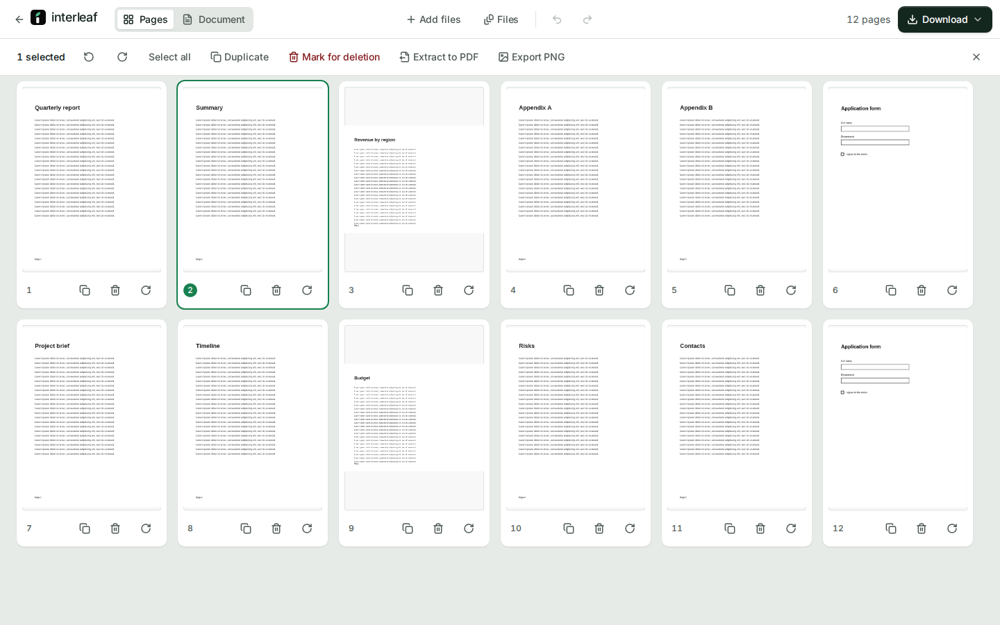

# Interleaf

Interleaf is a PDF editor that runs in your browser.

Use it at [interleaf.cc](https://www.interleaf.cc).



## Features

- Combine PDFs and PNG or JPEG images into one document
- Reorder, rotate, duplicate and delete pages
- Add text and checkmarks, and fill simple form fields
- Extract pages to a new PDF or export them as PNG images
- Compress a PDF
- Open password-protected PDFs

## Privacy

Your files never leave your device. There is no account, no analytics and no tracking. You can confirm this in your browser's network inspector.

## Run it locally

Install [Bun](https://bun.sh) and Node.js (versions in `mise.toml`), then run:

```sh
bun install
bun run dev
```

Open http://localhost:4321.

## Contributing

See [CONTRIBUTING.md](CONTRIBUTING.md). To report a vulnerability, see [SECURITY.md](SECURITY.md).

## License

Interleaf's code is under the [MIT license](LICENSE). It bundles:

- [PDF.js](https://github.com/mozilla/pdf.js), Apache-2.0
- [pdf-lib](https://github.com/Hopding/pdf-lib), MIT
- [qpdf](https://github.com/qpdf/qpdf) compiled to WebAssembly, Apache-2.0. [public/qpdf/NOTICE.md](public/qpdf/NOTICE.md) lists the libraries linked in.
- [fflate](https://github.com/101arrowz/fflate), MIT
- [Solid](https://github.com/solidjs/solid), MIT
- [Effect](https://github.com/Effect-TS/effect), MIT
- [Lucide](https://github.com/lucide-icons/lucide) icons, ISC, with Feather-derived icons under MIT ([notice](public/licenses/lucide.txt))
- [Inter](https://github.com/rsms/inter) font, OFL-1.1 ([license](public/licenses/inter.txt))
